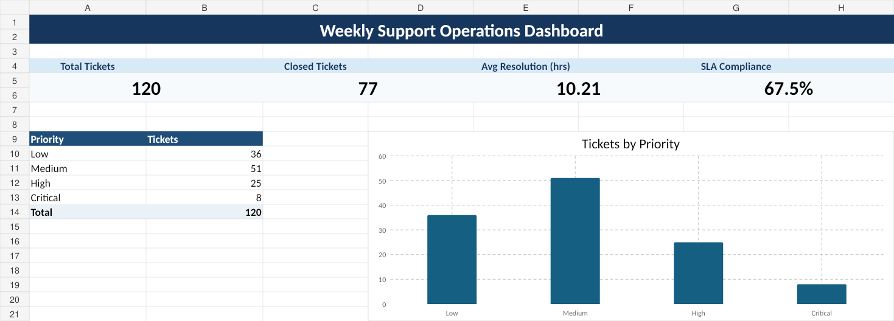

# Automated Report Generator

A Python portfolio project that converts raw support-ticket data into a management-ready Excel report with KPIs, summaries, and charts.



## Business problem

Small teams often track support activity in Excel or CSV files but still spend time manually preparing weekly management reports.

This project automates that process. A raw ticket file is transformed into a formatted Excel workbook that gives managers a quick view of workload, ticket status, resolution performance, and SLA compliance.

## What the project does

- Reads support-ticket data from CSV or Excel
- Validates the required columns
- Cleans dates and numeric fields
- Calculates operational KPIs
- Summarizes tickets by status and priority
- Measures agent performance
- Measures category performance
- Calculates SLA compliance
- Generates Excel charts
- Produces a management-ready workbook automatically

## Example output

The included sample dataset contains 120 fictional support tickets.

The generated workbook includes:

1. **Dashboard** - headline KPIs and ticket-priority chart
2. **Ticket Summary** - status distribution and ticket share
3. **Agent Performance** - assigned tickets, closed tickets, average resolution time, and SLA compliance
4. **Category Analysis** - ticket volume and SLA performance by category
5. **Raw Data** - the source data used to build the report

A sample generated report is available at:

`output/weekly_support_report.xlsx`

## Technologies

- Python
- pandas
- XlsxWriter
- openpyxl
- Excel / CSV

## Project structure

```text
automated-report-generator/
├── input/
│   ├── support_tickets.csv
│   └── support_tickets.xlsx
├── output/
│   └── weekly_support_report.xlsx
├── screenshots/
│   └── dashboard_preview.png
├── report_generator.py
├── requirements.txt
└── README.md
```

## Run locally

### 1. Clone the repository

```bash
git clone https://github.com/MistFullNight/automated-report-generator.git
cd automated-report-generator
```

### 2. Install dependencies

```bash
pip install -r requirements.txt
```

### 3. Generate the report

Using the sample CSV:

```bash
python report_generator.py input/support_tickets.csv output/weekly_support_report.xlsx
```

You can also provide an Excel file with the same required column names.

## Required input columns

- Ticket ID
- Created Date
- Category
- Priority
- Status
- Assigned To
- Closed Date
- Resolution Hours
- SLA Target Hours
- SLA Met

## Potential business uses

The same reporting pattern can be adapted for:

- Help-desk and IT support reporting
- Customer-service operations
- Maintenance requests
- Incident tracking
- Sales activity reporting
- Project status reporting
- SLA and service-performance reporting

## Portfolio purpose

This project demonstrates practical skills in:

- Python automation
- Excel reporting
- Data cleaning
- KPI design
- Operational reporting
- Business-focused data presentation

It is designed as a portfolio example using fictional data only.

## Possible next improvements

- Date-range filtering
- PDF export
- Configurable SLA rules
- Automatic email delivery
- Interactive desktop or web interface
- Scheduled report generation
